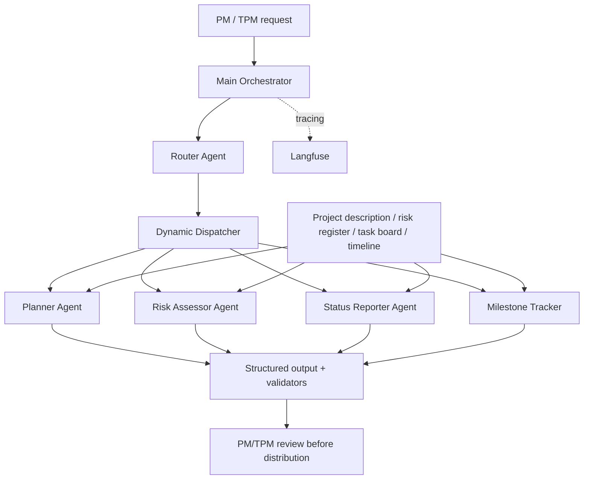

# Mira — AI-Powered Project Intelligence Assistant

**Multi-agent PM/TPM assistant | Langflow Desktop 1.11.0 | Langfuse | ABCDE Ltd. sample project**

Mira turns grounded project descriptions, task boards, timelines, and risk registers into project plans, risk assessments, weekly status reports, and milestone insights. The client project (ABCDE Ltd.'s AI adoption) is the *demonstration dataset*; Mira is the assistant built to support PMs/TPMs.

## Problem and solution
PMs/TPMs spend time manually preparing plans and status updates, and can miss risks or blockers. Mira uses a **Router/Dispatcher** to classify the request and invoke a specialized agent, rather than running every agent for every question.

## Architecture

## Components
| Workflow | Responsibility | Grounding |
|---|---|---|
| Main Orchestrator | Accept request, call router and dispatcher | User request and specialist results |
| Router | Classify plan/risk/status/milestone/unsupported | Request text |
| Planner | Structured phases, activities, milestones and timeline | Project description and timeline context |
| Risk Assessor | Categorized risks, impact and mitigation | Project description and risks |
| Status Reporter | Sprint-specific status, counts and blockers | Task board CSV |
| Milestone Tracker | Timeline and at-risk milestone insights | Project timeline CSV |

## Key design decisions
- **Router pattern:** reduces unnecessary specialist calls and keeps responsibilities separated.
- **Grounded generation:** preserve source evidence and distinguish facts from recommendations.
- **Validation:** structured output and explicit missing-data behavior; deterministic counts preferred over LLM arithmetic.
- **Human-in-the-loop:** all stakeholder-ready outputs are drafts, not automatically delivered.
- **Observability:** Langfuse traces for diagnostics and evaluation (see evidence folder).

## How to run
1. Install/open Langflow Desktop (project developed with version 1.11.0).
2. Configure the required LLM/API credentials in Langflow locally. **Never commit secrets.**
3. Import the JSON workflows in `workflows/`.
4. Verify the specialist flow IDs and update the Main Orchestrator's RunFlow/dispatcher references if imports generate new IDs.
5. Check local source-file paths, source contents, and each agent's inputs; reconfigure paths for your machine.
6. Test each specialist in Playground, then test the Main Orchestrator with the prompts in `evaluation/Mira_Official_Baseline_T1-T12.csv`.
7. Configure Langfuse locally and verify trace capture if using observability.

> **Important:** Exported workflows may need credential, flow-ID, and local-path reconfiguration. This repository is a reproducible capstone artifact, not a deployed SaaS service.

## Evaluation status and evidence
- The baseline dataset has **12 cases** covering detailed/vague planning, risk, status, blocker identification, milestone tracking and stakeholder communication.
- Earlier interactive testing was reported as **12/12 passed**; complete machine-readable successful responses have **not** been independently captured for this repository.
- A later automated API capture attempt returned **HTTP 400 for all 12** (authentication/request troubleshooting), so those attempts **must not be represented as successful agent evaluations**.
- See `evaluation/EVALUATION_REPORT.md` for evidence limits, metrics and next steps. Add verified Playground screenshots before submission.

## Scope
Core: planning, risk assessment, weekly status reporting. Extended: milestone tracking. Optional future enhancements: reviewed Slack notifications or email exports. Live Gmail/Slack sending is **not implemented or required**.

## Repository contents
- `workflows/`: six Langflow exports (review credentials and paths before publishing)
- `data/`: source reference data derived from provided capstone files
- `evaluation/`: official 12-case baseline inputs and evidence summary
- `docs/`: Q1 ideation, Q2 build/evaluation, Q3 charter, Q4 reflection, architecture and submission checklist
- `evidence/`: add workflow canvas, Playground and Langfuse screenshots

## Security and limitations
Use sample project data only; do not commit API keys, tokens, private emails or real client data. Source-file paths and flow IDs may be machine-specific. Output requires human review. No automatic stakeholder delivery, enterprise auth, live Jira write-back or production reliability claims.
